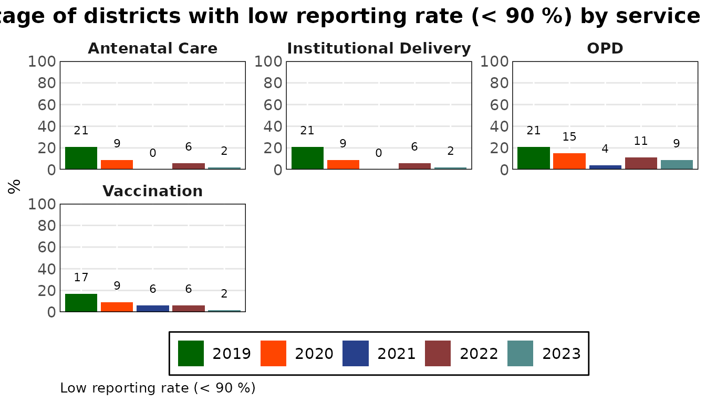
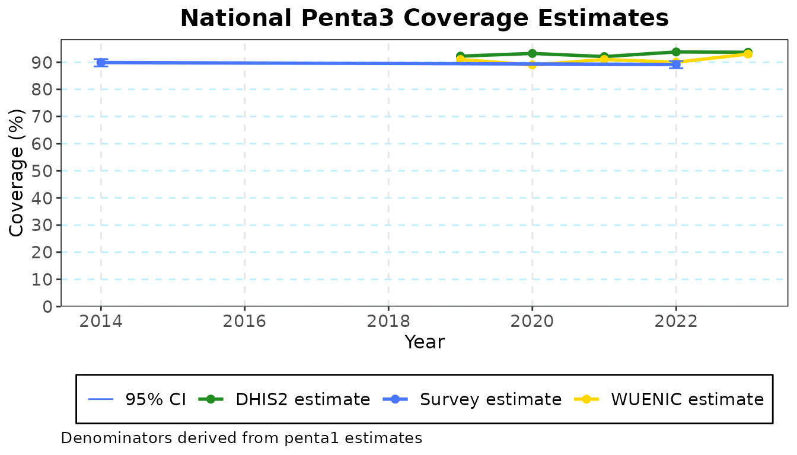

# Get started with cd2030.core

cd2030.core is the Countdown to 2030 analysis of routine health facility
data. This guide loads a dataset, looks at its quality, computes
coverage and saves the work, in about twenty lines of R. Each step has
its own guide with the detail:

| Step | Guide |
|----|----|
| What a dataset file must contain | [`vignette("preparing-data")`](../articles/preparing-data.md) |
| Reporting rates, outliers, missing values, consistency | [`vignette("data-quality")`](../articles/data-quality.md) |
| Adjustment, denominators, coverage, reports | [`vignette("coverage")`](../articles/coverage.md) |
| The Shiny apps built on this package | [`vignette("building-an-app")`](../articles/building-an-app.md) |

## Install

The package is published on r-universe, not CRAN. datasuite.ui, which it
needs, is in the same repository.

``` r

install.packages(
  "cd2030.core",
  repos = c("https://damurka.r-universe.dev", "https://alkemalab.r-universe.dev", "https://cloud.r-project.org")
)
```

Add `dependencies = TRUE` for the optional features: PDF and PowerPoint
export, and the Bayesian coverage model.

## Load a dataset

A dataset is the Countdown Excel workbook, a Stata `.dta` master file,
or an `.rds` saved by this package. The package comes with an example
workbook for Kenya.

``` r

library(cd2030.core)

path <- system.file("extdata", "kenya.xlsx", package = "cd2030.core")
cache <- load_cache_data(path)
#> ℹ Loading Excel "kenya.xlsx" for parts
#> ! The following columns are empty: anc_1trimester, under5_deaths, total_deaths, ipv2, measles_cases
#> ℹ Successfully loaded and cleaned data
#> ℹ Auto-detect candidates (|group|): vaccine=19, rmncah=28 -> selected rmncah
```

Loading reads the sheets, cleans the column names, merges them into one
table with a row per district and month, and works out which indicator
group the file holds (`"rmncah"` or `"vaccine"`). It also names the
columns that are empty.

`cache` is a `CacheConnection`: the data together with every choice made
about it (years removed, adjustment factors, denominators, surveys). The
data itself is a tibble of class `cd_data`.

``` r

data <- cache$countdown_data
data
#> ───────────────────────────────────── Countdown Object Summary ─────────────────────────────────────
#> 
#> ── Data Summary ──
#> 
#> • Number of observations: 2820
#> • Number of variables: 73
#> • Number of years: 5
#> • Number of regions: 8
#> 
#> ── Years Available ──
#> 
#> • 2019
#> • 2020
#> • 2021
#> • 2022
#> • 2023
#> 
#> ── Regions Available ──
#> 
#> • Rift Valley
#> • Western
#> • Eastern
#> • North Eastern
#> • Nyanza
#> • Central
#> • Coast
#> • Nairobi
#> 
#> ── Variable Groups Available ──
#> 
#> * anc: anc1, anc_1trimester, anc4, ipt2, ipt3, syphilis_test, ifa90, hiv_test
#> * idelv: sba, ideliv, instlivebirths, csection, low_bweight, pnc48h, total_stillbirth,
#> stillbirth_f, stillbirth_m, maternal_deaths, neonatal_deaths
#> * vacc: penta1, penta3, measles1, measles2, bcg
#> * opd: opd_total, opd_under5
#> * ipd: ipd_total, ipd_under5
#> ────────────────────────────────────────────────────────────────────────────────────────────────────
#> # A tibble: 2,820 × 73
#>   country adminlevel_1 district  year month     anc1 anc_1trimester  anc4  ipt2  ipt3 ifa90
#>   <chr>   <chr>        <chr>    <int> <ord>    <dbl>          <dbl> <dbl> <dbl> <dbl> <dbl>
#> 1 Kenya   Rift Valley  Baringo   2019 January   2006             NA   750    11    NA    NA
#> 2 Kenya   Rift Valley  Baringo   2019 February  1237             NA   676    NA    NA    NA
#> 3 Kenya   Rift Valley  Baringo   2019 March     1511             NA   796    NA    NA    NA
#> 4 Kenya   Rift Valley  Baringo   2019 April     1575             NA   889    NA    NA    NA
#> 5 Kenya   Rift Valley  Baringo   2019 May       1768             NA   878    NA    NA    NA
#> # ℹ 2,815 more rows
#> # ℹ 62 more variables: syphilis_test <dbl>, hiv_test <dbl>, sba <dbl>, ideliv <dbl>,
#> #   instlivebirths <dbl>, csection <dbl>, …
```

For the country it found, the package fills in the reference data it
holds: UN population estimates, WUENIC immunization estimates and the
household surveys.

``` r

cache$country
#> [1] "Kenya"
cache$survey_years
#> [1] 2014 2022
```

If you only want the data, `load_data(path)` returns the `cd_data`
tibble without the `CacheConnection`.

## Look at the quality of the data

The quality functions take the data and return a table. Most take an
administrative level: `"national"`, `"adminlevel_1"` (region) or
`"district"`.

``` r

calculate_average_reporting_rate(data)
#> # Table 1a: Annual average reporting rates for all indicators, by year
#> # A tibble: 5 × 6
#>    year anc_rr idelv_rr vacc_rr opd_rr mean_rr
#>   <int>  <dbl>    <dbl>   <dbl>  <dbl>   <dbl>
#> 1  2019     94       94      94     95      94
#> 2  2020     96       96      95     96      96
#> 3  2021     96       96      96     96      96
#> 4  2022     97       97      97     96      97
#> 5  2023     97       97      98     97      97
```

Most results have a
[`plot()`](https://rdrr.io/r/graphics/plot.default.html) method.

``` r

plot(calculate_district_reporting_rate(data, threshold = 90))
```



[`calculate_overall_score()`](../reference/calculate_overall_score.md)
puts the checks in one table: completeness, extreme outliers,
consistency between related indicators, and a score for each year.

``` r

calculate_overall_score(data, threshold = 90)[, c("no", "Data Quality Metrics", "2022", "2023")]
#> # A tibble: 10 × 4
#>    no    `Data Quality Metrics`                                       `2022` `2023`
#>    <chr> <chr>                                                         <dbl>  <dbl>
#>  1 1a    % of expected monthly facility reports (national)             96.4   96.9 
#>  2 1b    % of districts with completeness of facility reporting >= 90  93     96   
#>  3 1c    % of districts with no missing values for the 4 forms         84.0   84.7 
#>  4 2a    % of monthly values that are not extreme outliers (national)  98.8   96.1 
#>  5 2b    % of districts with no extreme outliers in the year           91.7   87.2 
#>  6 3a    Ratio anc1/penta1                                              1.07   1.06
#>  7 3b    Ratio penta1/penta3                                            1.04   1.04
#>  8 3c    % district with anc1/penta1 in expected ranged                87.2   85.1 
#>  9 3d    % district with penta1/penta3 in expected ranged              87.2   93.6 
#> 10 4     Annual data quality score                                     91.2   91.4
```

## Adjust the data and compute coverage

Coverage is computed from adjusted data: counts scaled up for incomplete
reporting, with extreme outliers and missing values replaced. The
`CacheConnection` does this with the settings it holds and keeps the
result.

``` r

cache$set_k_factors(c(anc = 0.25, idelv = 0.25, vacc = 0.25, opd = 0.25, ipd = 0.25))
cache$adjust_data()
```

Coverage also needs a few national rates. Those the country’s latest
survey has are already filled in; this survey has no stillbirth rate, so
it is given here.

``` r

cache$set_national_estimates(list(sbr = 0.02))

coverage <- cache$get_filtered_coverage("penta3", "national")
coverage
#> # A tibble: 5 × 7
#>   estimates        `2014` `2019` `2020` `2021` `2022` `2023`
#>   <chr>             <dbl>  <dbl>  <dbl>  <dbl>  <dbl>  <dbl>
#> 1 DHIS2 estimate     NA     92.2   93.2   92.1   93.8   93.7
#> 2 Survey estimates   89.9   NA     NA     NA     89.2   NA  
#> 3 95% CI LL          88.5   NA     NA     NA     87.8   NA  
#> 4 95% CI UL          91.1   NA     NA     NA     90.4   NA  
#> 5 WUENIC estimates   NA     91     89     91     90     93
```

The table sets the facility-data estimate beside the survey and WUENIC
estimates, and so does its chart.

``` r

plot(coverage)
```



## Save the work

Give the dataset a path and it saves itself there, now and after each
later change. [`load_cache_data()`](../reference/load_cache_data.md)
opens the file again with every choice as it was.

``` r

saved <- file.path(tempdir(), "kenya.rds")
cache$set_cache_path(saved)
#> ℹ Successfully saved to "/tmp/RtmpXh91H8/kenya.rds".

reopened <- load_cache_data(saved)
reopened$k_factors
#>   anc idelv  vacc   opd   ipd 
#>  0.25  0.25  0.25  0.25  0.25
```

## Where to go next

- [`vignette("preparing-data")`](../articles/preparing-data.md)
  describes the workbook and how to check your own file.
- [`vignette("data-quality")`](../articles/data-quality.md) and
  [`vignette("coverage")`](../articles/coverage.md) follow the analysis
  step by step.
- The reference lists every function by analysis step.
  [`?CacheConnection`](../reference/CacheConnection.md) lists everything
  the dataset object holds and computes.
- The same analysis is available without writing R in the Countdown apps
  (cd2030.rmncah, cd2030.vaxx), which run inside DataSuite.
  [`vignette("building-an-app")`](../articles/building-an-app.md)
  describes how they are built.
