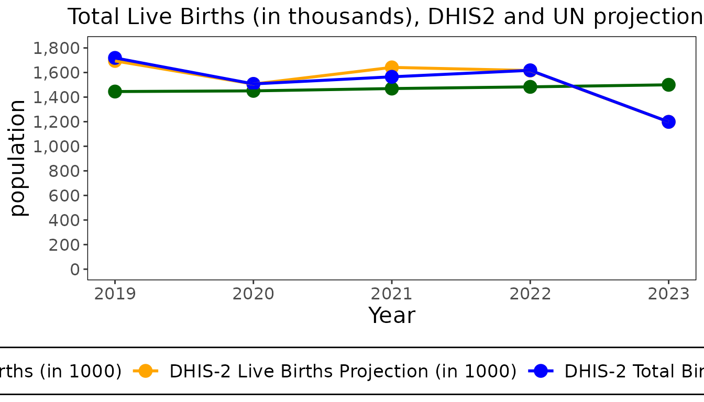
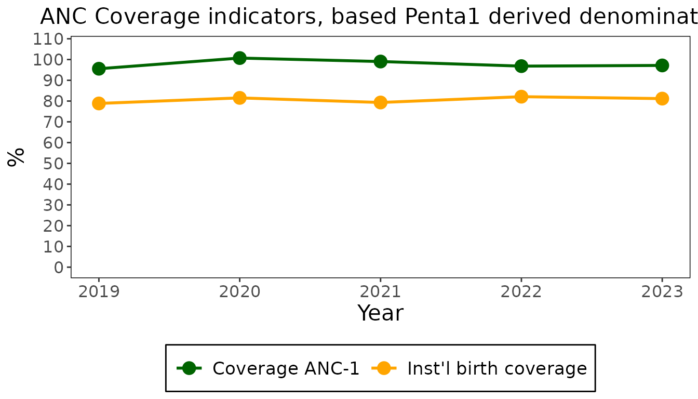
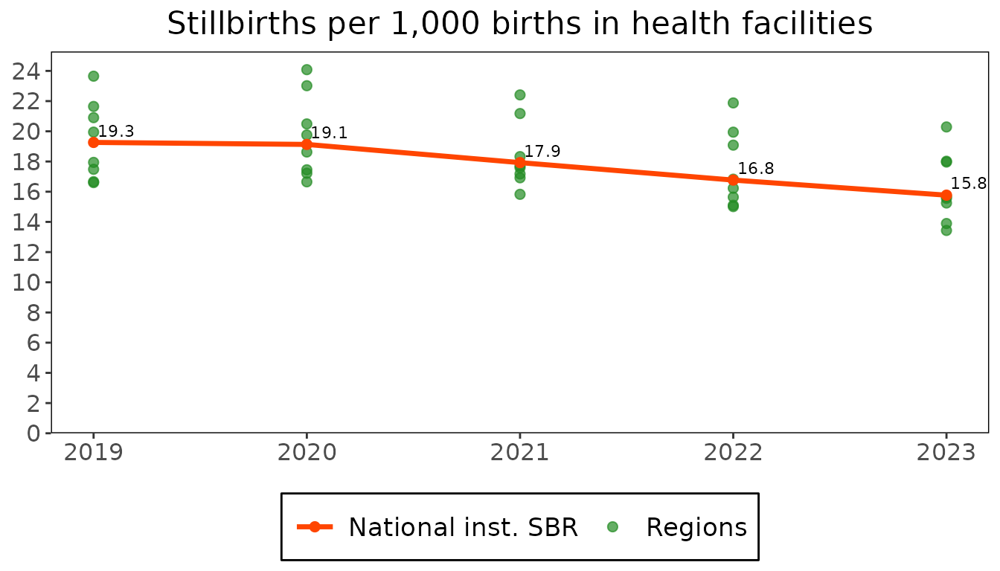

# From adjustment to coverage

Coverage is a count of services divided by the population that should
have received them. Both sides need work: the counts are adjusted for
what was not reported, and the population (the denominator) can be
estimated in several ways. This guide follows the steps with the dataset
object, the `CacheConnection`, which remembers each choice and computes
the results from them.

``` r

library(cd2030.core)

cache <- load_cache_data(system.file("extdata", "kenya.xlsx", package = "cd2030.core"))
#> ℹ Loading Excel "kenya.xlsx" for parts
#> ! The following columns are empty: anc_1trimester, under5_deaths, total_deaths, ipv2, measles_cases
#> ℹ Successfully loaded and cleaned data
#> ℹ Auto-detect candidates (|group|): vaccine=19, rmncah=28 -> selected rmncah
```

## 1. Adjust the counts

Adjustment does three things to the monthly counts:

1.  **Scales them up for incomplete reporting.** With a reporting rate
    of *r* percent, a count becomes `count * (1 + (100 / r - 1) * k)`.
    The factor *k*, between 0 and 1, says how much service the
    facilities that did not report are assumed to have given, compared
    with those that did: 0 means none, 1 means as much.
2.  **Replaces extreme outliers** (a month more than five median
    absolute deviations from the district’s median) with the district’s
    median for the year.
3.  **Fills missing values** with the district’s median for the year.

There is one *k* for each group of indicators.

``` r

cache$set_k_factors(c(anc = 0.25, idelv = 0.25, vacc = 0.25, opd = 0.25, ipd = 0.25))
cache$adjust_data()
```

The adjusted data is kept beside the original, and `adjustment_values`
shows what the adjustment changed, year by year.

``` r

changes <- cache$adjustment_values
changes[, c("year", "penta1_raw", "penta1_adj", "anc1_raw", "anc1_adj")]
#> # Table 1:  Unadjusted and adjusted values
#> # A tibble: 5 × 5
#>    year penta1_raw penta1_adj anc1_raw anc1_adj
#>   <int>      <dbl>      <dbl>    <dbl>    <dbl>
#> 1  2019    1359967   1380255. 1429512  1451735.
#> 2  2020    1323091   1345884. 1465266  1491785.
#> 3  2021    1411557   1424787. 1547683. 1553043.
#> 4  2022    1387864   1398699. 1479978. 1490510.
#> 5  2023    1410586   1412664. 1500341  1510589.
```

A year can be left out altogether with `cache$set_excluded_years()`.
Without the dataset object, the same adjustment is
`adjust_service_data(data, adjustment = "custom", k_factors = ...)`.

## 2. Compare the denominators

The populations come from two sources: the projections in the facility
data’s population sheet (called `dhis2`) and the UN estimates (`un`).

``` r

populations <- cache$denominator_metrics
populations[, c("year", "un_births", "totlivebirths_dhis2", "un_under1", "totunder1_dhis2")]
#> # Table 2a: Total Population and Live Birth by Source
#> # Country:  Kenya
#> # A tibble: 5 × 5
#>    year un_births totlivebirths_dhis2 un_under1 totunder1_dhis2
#>   <dbl>     <dbl>               <dbl>     <dbl>           <dbl>
#> 1  2019     1445.               1694.     1407.           1602.
#> 2  2020     1451.               1506.     1407.           1459.
#> 3  2021     1469.               1642.     1419.           1509.
#> 4  2022     1483.               1616.     1436.           1563.
#> 5  2023     1500.               1199.     1453.           1602.
```

``` r

plot(populations, metric = "births")
```



Two more denominators are derived from the service counts themselves.
Where nearly every pregnant woman attends a first antenatal visit, or
nearly every infant receives a first dose of pentavalent vaccine, the
count divided by the survey coverage of that service estimates the
population.

``` r

cd_denominator_labels()
#>                         un                      dhis2                       anc1 
#>           "UN projections"        "DHIS2 projections"             "ANC1-derived" 
#>                     penta1                anc1derived              penta1derived 
#>           "Penta1-derived"   "ANC1 population growth" "Penta1 population growth"
```

## 3. Give the national rates

The derived denominators step from one population to the next
(pregnancies to births to surviving infants) with a few national rates.
The package fills in those the country’s latest survey has.

``` r

str(cache$national_estimates)
#> List of 7
#>  $ nmr      : num 0.023
#>  $ pnmr     : num 0.0121
#>  $ twin_rate: num 0.015
#>  $ preg_loss: num 0.03
#>  $ sbr      : logi NA
#>  $ anc1     : num 0.98
#>  $ penta1   : num 0.971
```

Every rate is needed. This survey has no stillbirth rate, so it is set
here; the others can be replaced the same way.

``` r

cache$set_national_estimates(list(sbr = 0.02))
cache$check_inequality_params
#> [1] TRUE
```

`check_inequality_params` and `check_coverage_params` say whether the
dataset has what the coverage calculations need. When one is `FALSE`,
something is missing: adjusted data, a survey year, a national rate, or
the UN, WUENIC or survey estimates.

## 4. Compute coverage

`indicator_coverage_national` has the populations and coverage of every
indicator under every denominator. Columns are named
`cov_<indicator>_<denominator>`.

``` r

coverage <- cache$indicator_coverage_national
coverage[, c("year", "cov_penta3_dhis2", "cov_penta3_un", "cov_penta3_anc1", "cov_penta3_penta1")]
#> # Table:    National Coverage Estimates
#> # A tibble: 5 × 5
#>    year cov_penta3_dhis2 cov_penta3_un cov_penta3_anc1 cov_penta3_penta1
#>   <dbl>            <dbl>         <dbl>           <dbl>             <dbl>
#> 1  2019             79.2          92.9            94.6              92.2
#> 2  2020             87.8          91.2            90.7              93.2
#> 3  2021             84.2          94.1            91.1              92.1
#> 4  2022             85.6          93.2            94.9              93.8
#> 5  2023            116.           93.0            94.5              93.7
```

``` r

plot(coverage, plot_type = "anc_coverage_penta1")
```



The denominators do not agree, which is why they are compared. A
coverage above 100, as the facility projections give for 2023, means
that denominator is too small for the services counted.

The same tables exist by region and by district:
`indicator_coverage_admin1`, `indicator_coverage_district`.

## 5. Choose a denominator

The denominator to use is the one whose coverage agrees best with the
surveys. `denominator` is the one chosen for the dataset, and
`maternal_denominator` the one for maternal indicators.

``` r

cache$denominator
#> [1] "penta1"
cache$set_denominator("penta1")
```

## 6. Compare with surveys and WUENIC

`get_filtered_coverage()` takes one indicator, with the chosen
denominator, and sets the facility-data estimate beside the survey
estimates, their confidence interval, and the WUENIC estimates.

``` r

penta3 <- cache$get_filtered_coverage("penta3", "national")
penta3
#> # A tibble: 5 × 7
#>   estimates        `2014` `2019` `2020` `2021` `2022` `2023`
#>   <chr>             <dbl>  <dbl>  <dbl>  <dbl>  <dbl>  <dbl>
#> 1 DHIS2 estimate     NA     92.2   93.2   92.1   93.8   93.7
#> 2 Survey estimates   89.9   NA     NA     NA     89.2   NA  
#> 3 95% CI LL          88.5   NA     NA     NA     87.8   NA  
#> 4 95% CI UL          91.1   NA     NA     NA     90.4   NA  
#> 5 WUENIC estimates   NA     91     89     91     90     93
```

``` r

plot(penta3)
```


## Beyond coverage

The dataset object computes the other analyses the same way. Each is
described in [`?CacheConnection`](../reference/CacheConnection.md) and
under its heading in the reference.

``` r

mortality <- cache$mortality_summary
plot(mortality, indicator = "sbr_inst")
```



| Analysis | From the dataset object |
|----|----|
| Sub-national inequality | `get_filtered_inequality()`, `inequality_admin1`, `inequality_district` |
| Institutional mortality | `mortality_summary`, `mortality_ratios` |
| Service utilization | `service_utilization_national`, `service_utilization_admin1` |
| Health system | `health_system_metrics_national`, `health_system_comparison` |
| Family planning | `fpet_data` |

## Write a report

[`report_presets()`](../reference/report_presets.md) are Countdown’s
standard reports.
[`export_report()`](https://rdrr.io/pkg/datasuite.ui/man/export_report.html)
writes one for a dataset, as Word, PDF or a PowerPoint deck.

``` r

names(report_presets("en"))
#>  [1] "data_quality"          "adjustment"            "denominator_selection" "national_coverage"    
#>  [5] "national_inequality"   "mortality"             "service_utilization"   "health_system"        
#>  [9] "private_sector"        "synthesis"             "one_pager"
```

``` r

reports <- report_presets("en")
export_report(cache, reports[["national_coverage"]], "national-coverage.docx", format = "docx")
```

## Save the dataset

``` r

cache$set_cache_path("kenya.rds")
```

From then on the dataset saves itself after each change, and
`load_cache_data("kenya.rds")` opens it with the adjustment, rates and
denominators set here.
