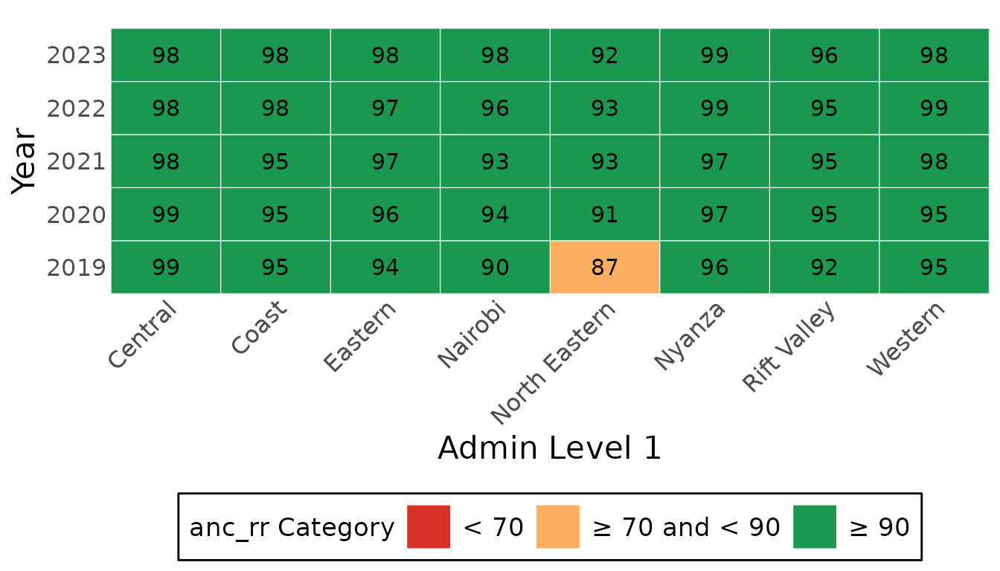
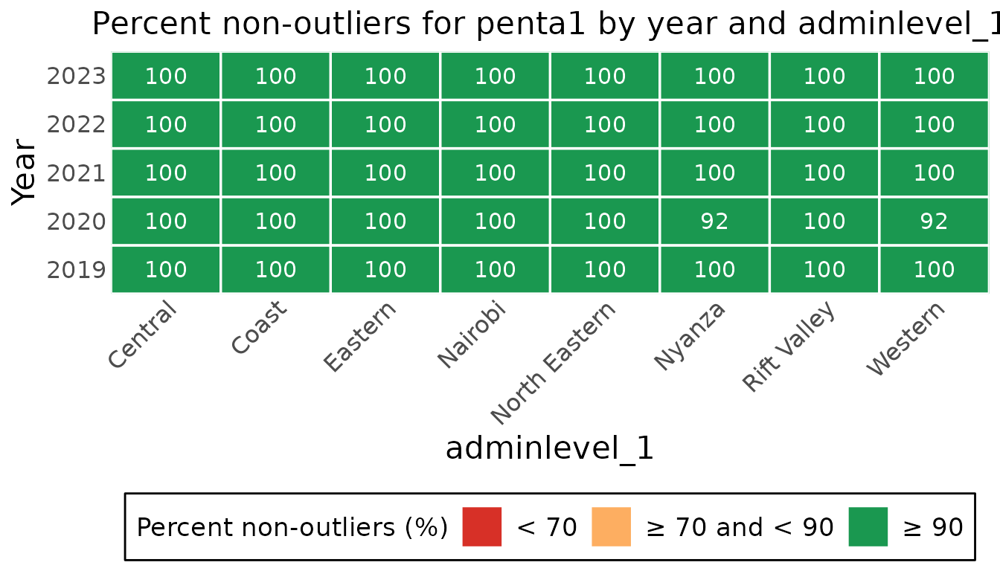
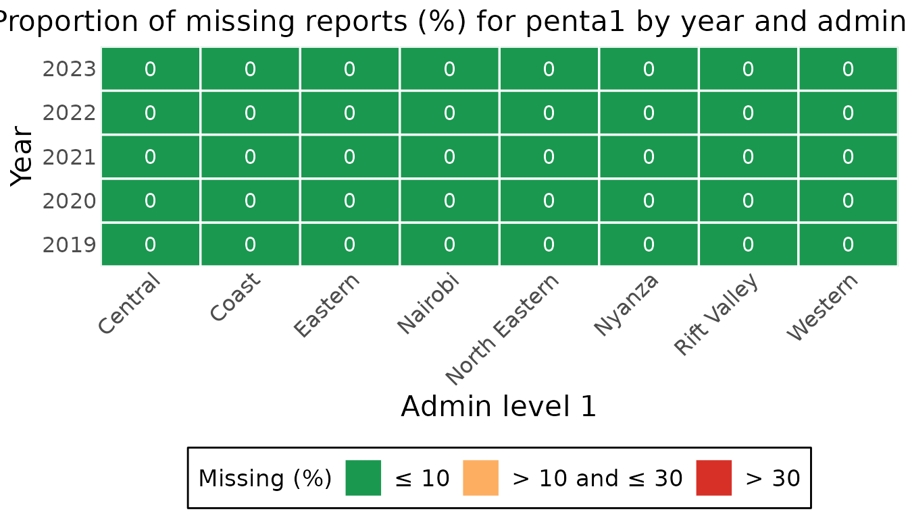
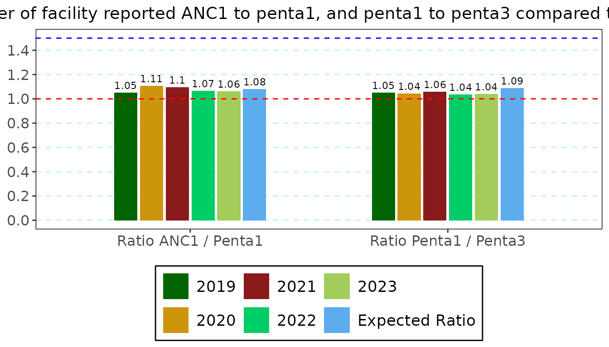
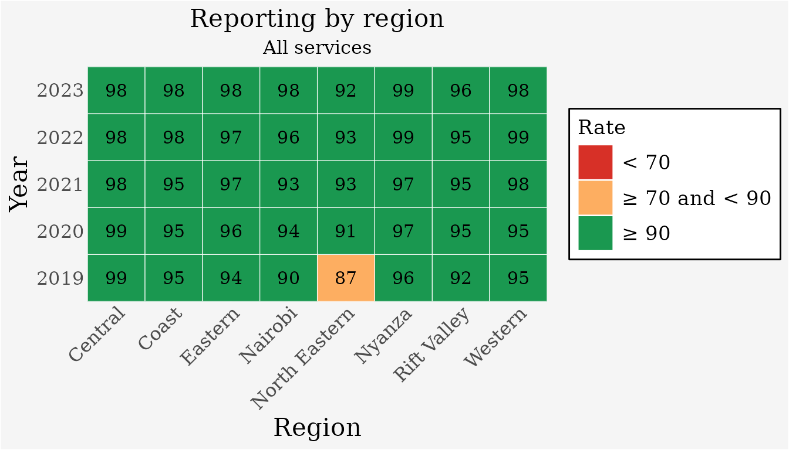
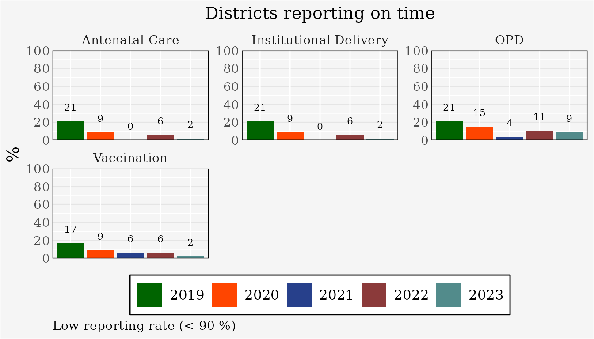

# Checking data quality

Before coverage is computed, the Countdown analysis asks four questions
of the facility data: were the reports sent, are there values that
cannot be right, are values missing, and do related indicators agree.
This guide goes through the function for each, on the example dataset.

``` r

library(cd2030.core)

cache <- load_cache_data(system.file("extdata", "kenya.xlsx", package = "cd2030.core"))
#> ℹ Loading Excel "kenya.xlsx" for parts
#> ! The following columns are empty: anc_1trimester, under5_deaths, total_deaths, ipv2, measles_cases
#> ℹ Successfully loaded and cleaned data
#> ℹ Auto-detect candidates (|group|): vaccine=19, rmncah=28 -> selected rmncah
data <- cache$countdown_data
```

Three things are the same for every check:

- **The level.** `admin_level` is `"national"`, `"adminlevel_1"`
  (region) or `"district"`, and `region` keeps one region.
- **The result** is a table with a class of its own, which gives it a
  caption and usually a
  [`plot()`](https://rdrr.io/r/graphics/plot.default.html) method.
- **The threshold** is the reporting rate a district is expected to
  reach, in percent. 90 is used here.

## Reporting rates

The reporting rate is the share of expected monthly reports that were
received, for each group of services.

``` r

calculate_average_reporting_rate(data)
#> # Table 1a: Annual average reporting rates for all indicators, by year
#> # A tibble: 5 × 6
#>    year anc_rr idelv_rr vacc_rr opd_rr mean_rr
#>   <int>  <dbl>    <dbl>   <dbl>  <dbl>   <dbl>
#> 1  2019     94       94      94     95      94
#> 2  2020     96       96      95     96      96
#> 3  2021     96       96      96     96      96
#> 4  2022     97       97      97     96      97
#> 5  2023     97       97      98     97      97
```

By region, as a chart:

``` r

plot(calculate_average_reporting_rate(data, admin_level = "adminlevel_1"))
```



[`calculate_district_reporting_rate()`](../reference/calculate_district_reporting_rate.md)
counts districts: the percentage whose reporting rate reaches the
threshold.

``` r

calculate_district_reporting_rate(data, threshold = 90)
#> # Table 1b: District reporting rates meeting threshold >= 90 by year
#> # A tibble: 5 × 6
#>    year low_anc_rr low_idelv_rr low_vacc_rr low_opd_rr low_mean_rr
#>   <int>      <dbl>        <dbl>       <dbl>      <dbl>       <dbl>
#> 1  2019         79           79          83         79          80
#> 2  2020         91           91          91         85          90
#> 3  2021        100          100          94         96          97
#> 4  2022         94           94          94         89          93
#> 5  2023         98           98          98         91          96
```

## Extreme outliers

A monthly value is an extreme outlier when it is more than five median
absolute deviations from the district’s median for that indicator. The
summary gives the percentage of values that are *not* outliers, so
higher is better.

``` r

outliers <- calculate_outliers_summary(data, admin_level = "adminlevel_1")
plot(outliers, selection_type = "heat_map", indicator = "penta1")
```



[`calculate_district_outlier_summary()`](../reference/calculate_district_outlier_summary.md)
gives the percentage of districts with no extreme outlier in the year,
and [`list_outlier_units()`](../reference/list_outlier_units.md) returns
the monthly values with their bounds, to find the months concerned.

``` r

calculate_district_outlier_summary(data)[, c("year", "anc1_outlier5std", "penta1_outlier5std", "penta3_outlier5std")]
#> # Table 2b: Percentage of districts with no extreme outliers, by year
#> # A tibble: 5 × 4
#>    year anc1_outlier5std penta1_outlier5std penta3_outlier5std
#>   <int>            <dbl>              <dbl>              <dbl>
#> 1  2019             97.9               97.9               93.6
#> 2  2020             76.6               83.0               70.2
#> 3  2021             87.2               97.9               85.1
#> 4  2022             97.9              100                100  
#> 5  2023            100                 97.9               97.9
```

## Missing values

Completeness is the percentage of monthly values that are present.

``` r

completeness <- calculate_completeness_summary(data, admin_level = "adminlevel_1")
plot(completeness, indicator = "penta1")
```



[`calculate_district_completeness_summary()`](../reference/calculate_district_completeness_summary.md)
gives the percentage of districts with no missing value, and
[`list_missing_units()`](../reference/list_missing_units.md) names the
districts and months where an indicator is missing.

``` r

list_missing_units(data, indicator = "low_bweight")
#> # A tibble: 144 × 4
#>   adminlevel_1 district  year month   
#>   <chr>        <chr>    <int> <ord>   
#> 1 Central      Nyeri     2022 January 
#> 2 Central      Nyeri     2022 February
#> 3 Central      Nyeri     2022 March   
#> 4 Central      Nyeri     2022 April   
#> 5 Central      Nyeri     2022 May     
#> # ℹ 139 more rows
```

## Consistency between indicators

Some indicators should move together: nearly every woman who attends a
first antenatal visit has a child who receives a first dose of
pentavalent vaccine, and the first dose is a little more common than the
third. The ratio of each pair is compared with the ratio expected from
survey coverage, the last row of the table.

``` r

cache$ratios_summary
#> # Table 3a.b: Ratios of ANC1/Penta1, Penta1/Penta3, and OPV1/OPV3 by Year
#> # A tibble:   6 × 6
#>   year               anc1  penta1  penta3 `Ratio anc1/penta1` `Ratio penta1/penta3`
#>   <chr>             <dbl>   <dbl>   <dbl>               <dbl>                 <dbl>
#> 1 2019           1429512  1359967 1293250                1.05                  1.05
#> 2 2020           1465266  1323091 1266781                1.11                  1.04
#> 3 2021           1547683. 1411557 1332230                1.10                  1.06
#> 4 2022           1479978. 1387864 1340620                1.07                  1.04
#> 5 2023           1500341  1410586 1355282                1.06                  1.04
#> 6 Expected Ratio      NA       NA      NA                1.08                  1.09
```

``` r

plot(cache$ratios_summary)
```



## The overall score

[`calculate_overall_score()`](../reference/calculate_overall_score.md)
brings the checks together, one row per measure and one column per year.
The last row is the year’s data quality score.

``` r

score <- calculate_overall_score(data, threshold = 90)
score[, c("no", "Data Quality Metrics", "2021", "2022", "2023")]
#> # A tibble: 10 × 5
#>    no    `Data Quality Metrics`                                       `2021` `2022` `2023`
#>    <chr> <chr>                                                         <dbl>  <dbl>  <dbl>
#>  1 1a    % of expected monthly facility reports (national)             95.9   96.4   96.9 
#>  2 1b    % of districts with completeness of facility reporting >= 90  97     93     96   
#>  3 1c    % of districts with no missing values for the 4 forms         84.9   84.0   84.7 
#>  4 2a    % of monthly values that are not extreme outliers (national)  97.8   98.8   96.1 
#>  5 2b    % of districts with no extreme outliers in the year           88.8   91.7   87.2 
#>  6 3a    Ratio anc1/penta1                                              1.10   1.07   1.06
#>  7 3b    Ratio penta1/penta3                                            1.06   1.04   1.04
#>  8 3c    % district with anc1/penta1 in expected ranged                91.5   87.2   85.1 
#>  9 3d    % district with penta1/penta3 in expected ranged              97.9   87.2   93.6 
#> 10 4     Annual data quality score                                     93.4   91.2   91.4
```

## Changing how a chart looks

Every chart in the package takes the same arguments for its text:
`title`, `subtitle`, `caption`, `x_title`, `y_title` and `legend_title`.
Anything else about its look is a chart option, given by name: the
background, fonts, sizes, the legend, the grid, the colours.

``` r

rates <- calculate_average_reporting_rate(data, admin_level = "adminlevel_1")

plot(rates,
     title = "Reporting by region", subtitle = "All services", x_title = "Region", legend_title = "Rate",
     background_color = "grey96", font_family = "serif", legend_position = "right")
```



To give several charts one look, make the options once and pass them as
`options`.

``` r

look <- cd_chart_options(font_family = "serif", background_color = "grey96", text_scale = 0.9)

plot(calculate_district_reporting_rate(data, threshold = 90), title = "Districts reporting on time", options = look)
```



[`?cd_plot_arguments`](../reference/cd_plot_arguments.md) describes the
shared arguments and
[`?cd_chart_options`](https://rdrr.io/pkg/datasuite.ui/man/cd_chart_options.html)
lists every option.

## Through the dataset object

The `CacheConnection` holds each of these tables, computed once with the
threshold it has stored and kept until something they depend on changes.
This is what the apps’ pages read.

``` r

cache$set_performance_threshold(90)
cache$reporting_rate_national
#> # Table 1a: Annual average reporting rates for all indicators, by year
#> # A tibble: 5 × 6
#>    year anc_rr idelv_rr vacc_rr opd_rr mean_rr
#>   <int>  <dbl>    <dbl>   <dbl>  <dbl>   <dbl>
#> 1  2019     94       94      94     95      94
#> 2  2020     96       96      95     96      96
#> 3  2021     96       96      96     96      96
#> 4  2022     97       97      97     96      97
#> 5  2023     97       97      98     97      97
```

[`?CacheConnection`](../reference/CacheConnection.md) lists them all
(`reporting_rate_*`, `completeness_*`, `outliers_*`, `ratios_summary`,
`overall_score`).

## Acting on what you find

- **A year too poor to use** can be left out of the analysis:
  `cache$set_excluded_years(2019)`.
- **Under-reporting, outliers and missing values** are corrected by
  adjustment, the next step:
  [`vignette("coverage")`](../articles/coverage.md).
- **A written summary**:
  `export_report(cache, report_presets("en")[["data_quality"]], "data-quality.docx")`
  writes the standard data quality report as a Word document.
